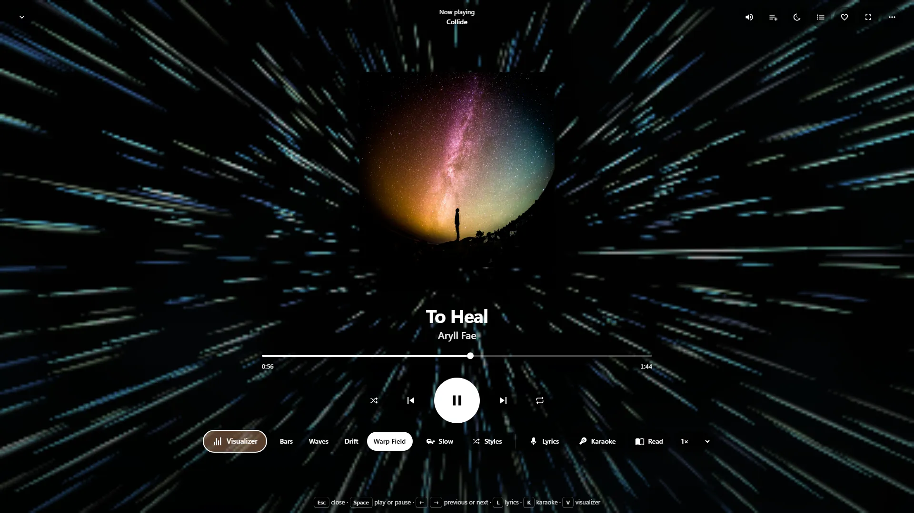
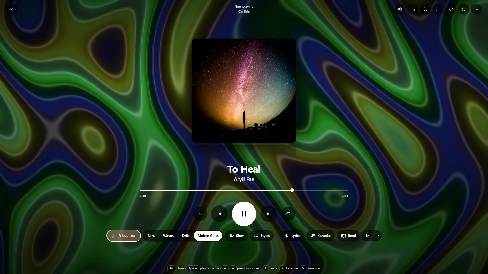
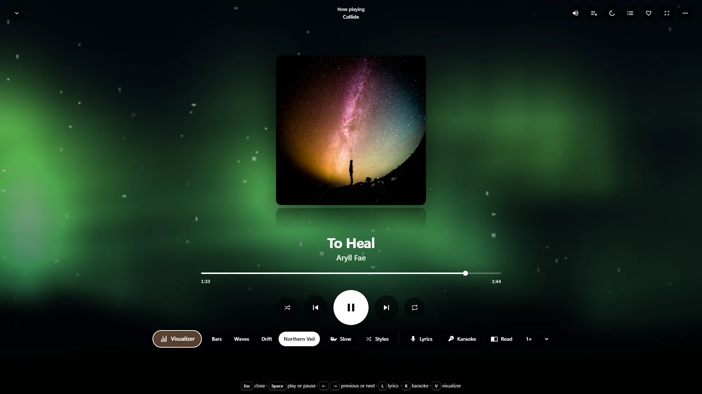

# WittyVisualizer

Light shows that follow your music, full screen: bars, scopes, plasma, tunnels, starfields, feedback and fire. It appears in WittyMediaServer's audio player and in WittyMediaPlayer, and you need it only if you want the pictures.

<!-- pictures -->



<sub>In WittyMediaServer's full-screen player, with [Collide](https://archive.org/details/SRS08807), Aryll Fae, [CC BY 4.0](https://creativecommons.org/licenses/by/4.0/).</sub>



<sub>Another effect, with [Collide](https://archive.org/details/SRS08807), Aryll Fae, [CC BY 4.0](https://creativecommons.org/licenses/by/4.0/).</sub>



<sub>A third, with [Collide](https://archive.org/details/SRS08807), Aryll Fae, [CC BY 4.0](https://creativecommons.org/licenses/by/4.0/).</sub>

<!-- /pictures -->

## What it does

It runs entirely on your device, with no work for the server. Nothing loads until you open it, and it's off until someone turns it on.

| Effect | What it is | Motion |
|---|---|---|
| **Skyline** | The classic spectrum: stacks of lights with falling caps and a wet reflection | gentle |
| **Phosphor Trace** | An oscilloscope: left and right, drawn by a beam on a lab screen with an afterglow | gentle |
| **Lantern Knots** | A vector scope: the sound against itself, as a looping line of light | gentle |
| **Molten Glass** | Sine plasma with a glassy sheen | gentle |
| **Wormhole** | A twisting tunnel whose walls carry the last second of the music | lively |
| **Warp Field** | A 3D starfield that stretches into streaks when the bass pushes | lively |
| **Ink Drift** | Feedback: each picture is the last one pulled in and stirred | gentle |
| **Prism Wheel** | A kaleidoscope that gains and loses sides | lively |
| **Ember Fountain** | Thousands of sparks, with a fresh burst on every beat | lively |
| **Sun Dial** | The spectrum wrapped around a disc | gentle |
| **Lava Lamp** | Soft blobs that merge and split | gentle |
| **Hearth** | A pixel fire fed by the music | gentle |
| **Horizon Run** | A wireframe landscape made of the last second of sound | lively |
| **Cascade** | A waterfall of sound | gentle |
| **Fractal Bloom** | A Julia fractal steered by the music | gentle |
| **Northern Veil** | Curtains of light over a starry sky | gentle |
| **Ripple Tank** | A pool where each beat is a drop | gentle |
| **Aurora Rings** | Glowing rings that swell with the bass | gentle |

Colours move with the beat through eight families. Effects change by a fade, a dissolve, an iris or a sweep.
Calm mode leaves out the lively ones.

Effects draw at whatever resolution holds the frame rate, down to a quarter of the pixels, and only then drop to 30 frames a second. The loop stops when the tab is hidden, the canvas is off screen or it's turned off. Where a browser has no WebGL 2, a plain canvas draws instead.

Every control is named, and everything works from a keyboard, a remote or a game controller.

You can add an effect of your own as a data file on your own device, in the web app only. It's treated as untrusted: only a small part of GLSL is allowed, its worst-case cost has to be under a fixed limit, and it's tried in a throwaway graphics context first. It still goes through the flash guard. See [Writing effects](wiki/Writing-effects.md).

### Safety

Flashing can harm people with photosensitive epilepsy, so:

- **It's off until someone turns it on,** after a notice the first time, and it never starts on its own.
- **Calm mode** is the default when the system asks for reduced motion: slower, softer, gentle effects only.
- **A flash guard sits in the last step of drawing,** where no effect can get around it, including ones people write.
  For each of 40 tiles of the screen it remembers how dark that tile has lately been, allows only a small step above that,
  and lets the memory itself climb slowly. So any swing within a third of a second is under 0.1 of relative
  luminance, which is the size below which WCAG 2.3.1 doesn't count it as a flash at all. Saturated red counts for more, as
  the guideline says. A full-screen black and white strobe comes out at a slow, dim glow: see [the tests](tests/safety.test.mjs).
- **Beats can't come faster** than about four a second, or two in calm mode.

No limiter makes moving light safe for everyone, and the notice says so. It hasn't been assessed by a clinician or with a
professional flash analyser.

The canvas is hidden from screen readers, every control is named, and everything works from a keyboard, a remote or a
game controller.

Where it's shown in the audio player, and how settings are saved per person, stay with the server.

How to use it is in **Help** inside WittyMediaServer: see Music, audiobooks and podcasts.

## How to get it

An admin adds it from the module store inside WittyMediaServer: **Settings → Modules**, then **Browse the store**, then **Add** beside WittyVisualizer. That needs WittyMediaServer 0.6.0-alpha or later, and it works with nothing older. The range this version fits is in `module.json`: 0.6.0-alpha through 0.6.x.

WittyMediaPlayer builds it in, so there's nothing to add there.

## What it needs

- A device with WebGL 2 for the full effects. A plain canvas stands in without it.
- React 18 or newer, which the app provides.
- For the desktop half: Qt 6, including its GuiPrivate and ShaderTools parts.

## Platforms

It's one browser bundle for every system the server runs on, and it runs on whichever device opens the server. It has been run in a Chromium browser through the real audio player, on a test server on Linux, with its gallery and flash checks. Safari, real phones and real TVs have not been tried.

In a browser, it listens to a copy of the sound where it can. Firefox's copy mutes the player and Safari has none, so there the player goes through an audio context, for a stream on the page's own address only. A stream from another address gets a gentle pattern, and it says so.

The desktop half (`qt/`) runs inside WittyMediaPlayer, which is built for Windows only.

## Building and testing

You need Node.js 22, as CI uses, and Go for the manifest check. In a worktree, first run the copy of `dev-modules.mjs` kept above the repositories (`node D:/projects/dev-modules.mjs` on the development machine). It writes only links that git ignores, so the checkout builds against the repositories beside it.

```bash
npm install
```

```bash
npm run build:bundle
```

That makes one script and one stylesheet, as a server installs them. To check the manifest:

```bash
go run github.com/wittywilla/wittymodule/cmd/wittymodule check .
```

```bash
npm test
```

| Command | What it does |
|---|---|
| `npm test` | Analysis, flash guard, file checks, effect order |
| `node tests/gallery-run.mjs sheet out.png` | A picture of every effect, with a Vite dev server |
| `node tests/gallery-run.mjs flash` | A strobe through the real guard |
| `node tests/player-check.mjs out` | Through a real player, on a test server |

`wvtests`, built with `-DWITTYVISUALIZER_TESTS=ON`, does the same for Qt, with no window.

An effect is one text file: a JSON description in a comment at the top, then GLSL. Both hosts read those same files, and `qt/CMakeLists.txt` bakes them for Direct3D, Metal, Vulkan and OpenGL at build time.

```
effects/*.glsl, palettes.json    the effects: the one source of truth
shaders/                         what every effect shares, and the guard and present passes
analysis.ts   qt/wvanalysis.cpp  listening: FFT, bands, beats (a shared test file holds them to the same numbers)
engine.ts     qt/wvengine.cpp    what comes next, colours, frame budget
safety.ts                        the flash guard's sums, and how to count flashes
gl.ts         qt/wvrenderer.cpp  drawing, on WebGL 2 and on QRhi
canvas2d.ts                      a plain canvas, where there's no WebGL 2
tap.ts        qt/wvtap.h         getting at the sound
session.ts, Stage.tsx            the web app's loop and interface
qt/wvwidget.cpp                  the desktop's
format.ts                        reads effect files; refuses unsafe ones someone adds
```

To use it in another app, see [Embedding](wiki/Embedding.md) and the rest of [wiki/](wiki/Home.md).

## Licence

GNU Affero General Public License v3.0 (or later): see [LICENSE](LICENSE) and [NOTICE](NOTICE). If you redistribute it or build on it, please keep the NOTICE attribution. Everything here was written for this project: nothing comes from any other program's effects, presets, names or code.


## In every app: its server-driven UI

It carries its own `sdui.json`: its theme scope, and **Settings, Visualizer** (each profile's own): the effect, from all 18; picking at random; auto-change; only favourites; calm mode with the flashing notice; intensity, speed, colour (the effect's own families or the theme's accent), sensitivity, quality and the frame rate. Every effect takes speed and colour. The effects picker's presets are the server's `music.visualizer.presets`, the same 18 effects as `effects/`.

**Stays in WittyVisualizer's own code:** the visualizer renderer itself, drawn over the music views of every look.

The file is checked with `wittymodule check` and described in WittyMediaServer's [docs/SDUI-MODULES.md](https://github.com/wittywilla/WittyMediaServer/blob/master/docs/SDUI-MODULES.md).

## Legal

WittyVisualizer is an independent open-source project. It isn't associated with, sponsored by or
endorsed by any maker of other media players or visualizers. This can show flashing lights and
fast-changing patterns, which may affect people with photosensitive conditions. Any third-party names
here only describe what it works with, and belong to their owners. It's provided “as is”, with no
warranty; see [LICENSE](LICENSE). Local law applies to how you use it. This isn't legal advice.

<!-- module-kit -->
## Releasing

A version tag builds the bundle for the browser, signs the checksum list, and publishes a release that servers can install.

Versions move in small steps as work lands. `go run github.com/wittywilla/wittymodule/cmd/wittymodule@v0.4.0 bump .` raises it
everywhere it is written (add `-part minor` for a bigger step). A bump isn't a release: nothing is
tagged or published until you tag it. CI fails when code changed since the last tag and the version
didn't, because tags never move.

To release:

1. Check that `version` in `module.json` is the one to publish, with the bump committed.
2. Tag that commit and push the tag: `git tag vX.Y.Z`, then `git push origin vX.Y.Z`. A tag with a
   suffix, such as `v1.2.0-beta`, is published as a prerelease.
3. Watch the *Actions* tab. The signing step uses the `WMS_SIGNING_KEY` secret of the `release` environment, and nothing is published without it.

To take a version back, run the *withdraw* workflow from the *Actions* tab. It adds the version to a signed list on the release tagged `withdrawals`, which servers read.

Licensed under AGPL-3.0-or-later: see [LICENSE](LICENSE) and [NOTICE](NOTICE).
<!-- /module-kit -->
